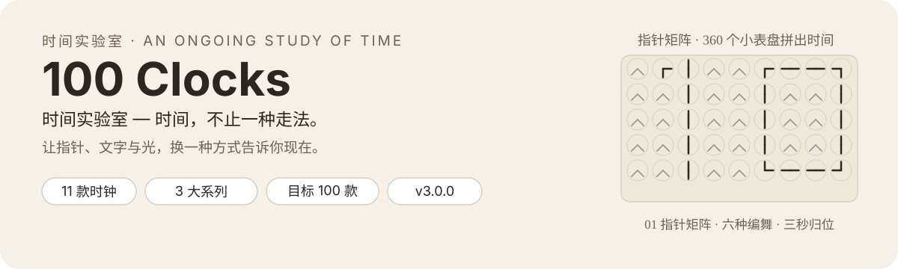
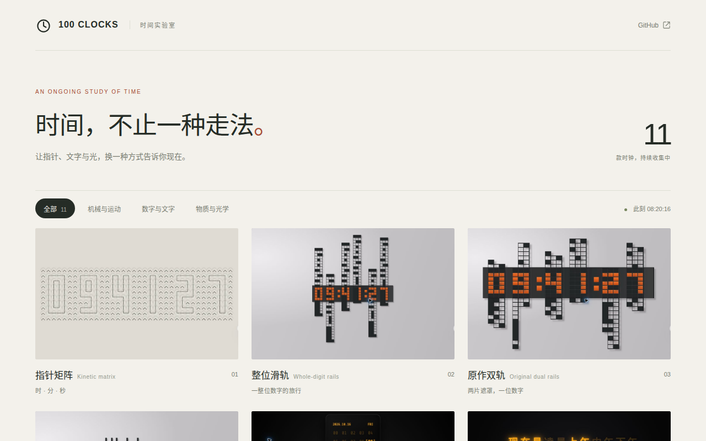
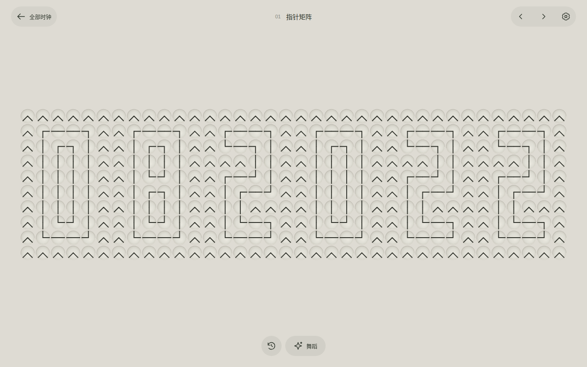

<p align="right"><a href="README.md">中文</a></p>

<p align="center">
  
</p>

<p align="center">
  <a href="https://100-clocks.xiaosang.cc/">▶ Try Online</a>
  ·
  <a href="https://holynova.github.io/100-clocks/">GitHub Pages Mirror</a>
  ·
  <a href="https://github.com/holynova/100-clocks">GitHub Repository</a>
</p>

100 Clocks is a time laboratory: 11 interactive web clocks so far, with 100 as the goal to grow toward. A kinetic matrix spells the time with 360 dials; rails let digits travel; word clocks read the time in Chinese or English; ferrofluid, moiré, and sand give time a material form. Click any clock for a fullscreen immersive view.

## Screenshots

<p align="center">
  
</p>

<p align="center">
  
</p>

## The 11 Clocks

### Mechanical & Motion

| No. | Clock | How it works |
| --- | --- | --- |
| 01 | 指针矩阵 (Kinetic Matrix) | 360 small dials (240 with seconds off); neighboring hands join along the inner and outer edges of each digit to draw a double-line outline; six manual choreographies (星旋 Star Swirl, 波浪 Wave, 涟漪 Ripple, 风车 Windmill, 棋盘 Checkerboard, 扇面 Fan) that return to the time in three seconds. |
| 02 | 整位滑轨 (Whole-Digit Rail) | Every digit shares one continuous fixed mask; the whole grid slides along the rail to find the next digit; supports Focus. |
| 03 | 原作双轨 (Original Dual Rail) | Hans Andersson's original masks and position tables; single-column and double-column rails move independently to compose digits; supports Focus. |
| 04 | 字母滑轨 (Alphabet Rail) | 53 glyphs, six-character input and rotation — time can also be a sentence; supports Focus. |

### Digital & Word

| No. | Clock | How it works |
| --- | --- | --- |
| 05 | 数字矩阵 (Digital Matrix) | The original Matrix Clock Ultra: amber glow, a 00–59 digit grid, hour brackets, seconds underline. |
| 06 | 中文文字时钟 (Chinese Word Clock) | The original Chinese glowing word matrix, minute precision, word-based seconds readout and themes. |
| 07 | 英文文字时钟 (English Word Clock) | A separate English glowing word matrix, minute precision, English seconds readout and themes. |

### Material & Optical

| No. | Clock | How it works |
| --- | --- | --- |
| 08 | 机器人写字 (Plotter Handwriting) | A two-link robotic arm writes stroke by stroke, erasing and rewriting each minute; ink color and rewrite supported. |
| 09 | 磁流体时钟 (Ferrofluid Clock) | Particles in a potential field gather into digits, slowly re-forming after a touch disturbs them; optional seconds and fluid color. |
| 10 | 莫尔纹时钟 (Moiré Clock) | Two grating layers reveal the time where they misalign; drag and invert, with an independent second hand. |
| 11 | 数字沙漏 (Digital Hourglass) | Sand grains fall into digit molds, collapsing and reforming each minute; seconds, color, and gravity options. |

## Common Controls

- All options live in the settings panel at the top right; on mobile, use the bottom panel.
- Every clock offers live, demo, speed, start time, pause, replay, and fullscreen; demo mode advances 1 minute every 3 seconds by default.
- Focus on the rail clocks makes the reading span 50% of the viewport width; long rails may run off-screen.
- Only one clock loads at a time; returning to the catalog destroys the instance. The kinetic matrix stops drawing when idle and pauses in the background.

## Run Locally

Vanilla HTML, CSS, and JavaScript, with no production runtime dependencies:

```bash
npm ci
npm run dev       # http://localhost:4179
npm run check     # glyph, original-CSS, geometry, time-source, and DOM checks
npm run build     # only public/ goes into dist/
```

Dev previews support `views/kinetic.html?preview&at=09:41:27`; add `&profile` to show frame rate and overhead.

## Tech

- Vanilla HTML + CSS + JavaScript, zero frameworks, zero production dependencies; one shared time source, each clock a standalone `views/*.html` page.
- The digital matrix and word clocks keep their original CSS intact, recorded in `docs/restored-styles.json` and checked by SHA-256 in tests.
- The rail implementation was merged from [time-slider-clock](https://github.com/holynova/time-slider-clock); imported versions and SHA-256 hashes are in `docs/imports.json`.
- The dual-rail geometry is Hans Andersson's, under CC BY-NC-SA 4.0 — see `public/views/ATTRIBUTION.txt`; inspiration for the experimental series is in `docs/experiments.md`.

```
public/
├── index.html          Collection page (catalog, categories, live readout)
├── views/              Standalone pages for the 11 clocks
├── assets/             catalog.js (catalog data) / app.js / clock implementations
└── previews/           Catalog thumbnails (real page screenshots)
tests/                  Node tests (glyphs / geometry / time source)
docs/                   audit.md (per-clock checks) / performance.md / experiments.md
```
