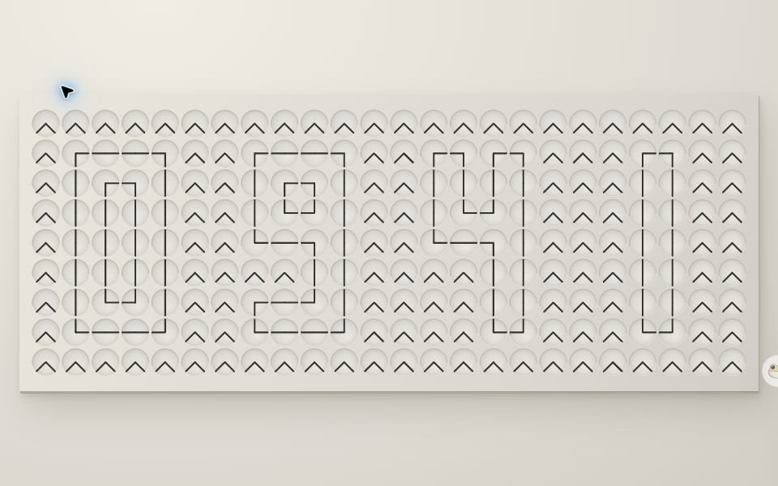

# 100 Clocks · 时间实验室

时间，不止一种走法。目前收录 **7 款**网页时钟，100 是逐步填满的目标。

[在线体验](https://100-clocks.xiaosang.cc/) · [指针矩阵](https://100-clocks.xiaosang.cc/?clock=kinetic) · [逐款检查](docs/audit.md) · [性能对比](docs/performance.md)



| 编号 | 时钟 | 实现 |
| --- | --- | --- |
| 01 | 指针矩阵 | 240 个表盘、480 根指针；可选时分秒模式（360 个表盘），双线轮廓。单 Canvas 绘制指针，缓存表盘底图。 |
| 02 | 分列滑轨 | 每列独立的固定镂空轨道。 |
| 03 | 整位滑轨 | 整位共享固定遮罩与位置。 |
| 04 | 原作双轨 | Hans Andersson 的原始遮罩与位置表。 |
| 05 | 字母滑轨 | 相同的 38 行轨道，支持 53 种字符、六字符输入与轮播。 |
| 06 | 数字矩阵 | 保留原版 Matrix Clock Ultra 的琥珀荧光、小时括号、秒数下划线、主题与字体。 |
| 07 | 文字时钟 | 保留原版中英文荧光文字矩阵、精度、文字读秒与主题。 |

06、07 的原始 CSS 保持一致，记录在 [restored-styles.json](docs/restored-styles.json)，测试检查其 SHA-256。仅做统一时间源、嵌入窗口适配及原有变量冲突的修复。08 及之后的四款已移出集合。

点选时钟进入全视窗沉浸展示，背景随主题同步。所有选项统一从右上角设置进入，手机使用底部面板。统一提供实时、演示、速度、起始时间、暂停、重播与全屏；默认演示每 3 秒前进 1 分钟。指针矩阵的字形上下等高，可选显示秒数；手机竖屏按两位一组排列。

## 开发

```sh
npm ci
npm run dev       # http://localhost:4179
npm run check     # 字形、原版 CSS、几何、时间源与 DOM 执行校验
npm run build     # 仅 public/ 进入 dist/
npm run deploy    # 发布到已有 Cloudflare Worker
```

原生 HTML、CSS、JavaScript，无生产运行时依赖。每次只加载一款时钟，回到目录即销毁实例。指针矩阵静止时停止绘制，后台暂停，画布像素比最高为 2。

GitHub Pages 在 main 推送后检查并部署 dist/；Cloudflare 从同一提交手动发布。目录缩略图来自实际网页截图。开发预览支持 `views/kinetic.html?preview&at=09:41:27`；加 `&profile` 可显示帧率与开销。

## 合并与来源

四款滑轨合并自 [time-slider-clock](https://github.com/holynova/time-slider-clock)，导入版本与 SHA-256 见 [imports.json](docs/imports.json)。旧滑轨线上地址分别跳转到本集合的对应版本，原仓库保留历史。

原作双轨几何归属 Hans Andersson，沿用 [CC BY-NC-SA 4.0](https://creativecommons.org/licenses/by-nc-sa/4.0/)，见 [ATTRIBUTION.txt](public/views/ATTRIBUTION.txt)。原版数字矩阵与文字时钟来自本仓库提交 67ba456。

旧的 word-clock.html、time-slider.html、time-slider-original.html 仍跳转到对应项目。移除的运动表旧入口返回目录。
