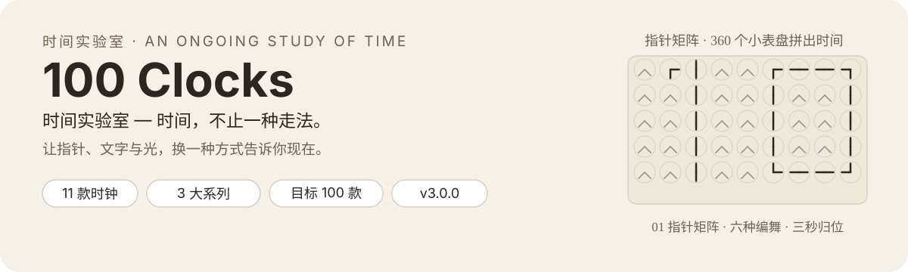
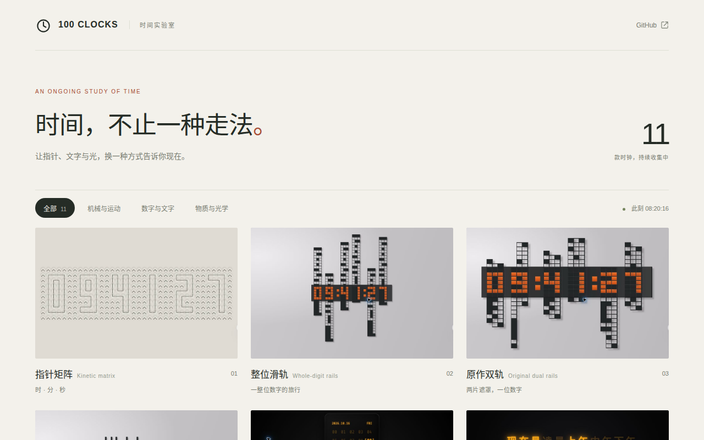
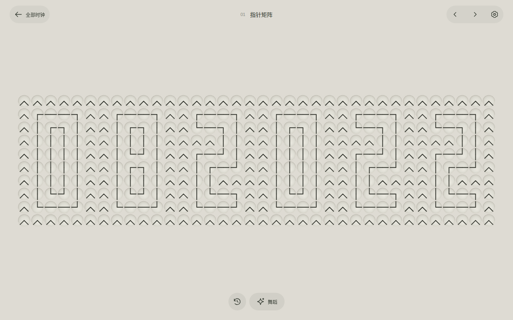

<p align="right"><a href="README.en.md">English</a></p>

<p align="center">
  
</p>

<p align="center">
  <a href="https://100-clocks.xiaosang.cc/">▶ 在线体验</a>
  ·
  <a href="https://holynova.github.io/100-clocks/">GitHub Pages 镜像</a>
  ·
  <a href="https://github.com/holynova/100-clocks">GitHub 仓库</a>
</p>

100 Clocks 是一个时间实验室：目前收录 **11 款**可交互网页时钟，100 是逐步填满的目标。指针矩阵用 360 个小表盘拼出时间，滑轨让数字沿轨道旅行，文字时钟用汉字读出此刻，磁流体、莫尔纹与沙漏让时间有了物质与光学形态。点选任意一款进入全屏沉浸展示。

## 截图

<p align="center">
  
</p>

<p align="center">
  
</p>

## 11 款时钟

### 机械与运动

| 编号 | 时钟 | 玩法 |
| --- | --- | --- |
| 01 | 指针矩阵 | 360 个小表盘（关秒数后 240 个），相邻指针沿数字内外两侧连接，拼出双线轮廓；六种手动编舞（星旋、波浪、涟漪、风车、棋盘、扇面），三秒归位。 |
| 02 | 整位滑轨 | 每一位数字共用一张连续固定遮罩，整张栅格沿轨道平移找下一位数字；支持 Focus。 |
| 03 | 原作双轨 | Hans Andersson 原作遮罩与位置表，单列 + 双列轨道独立移动组合数字；支持 Focus。 |
| 04 | 字母滑轨 | 53 种字符、六字符输入与轮播，时间也可以是一句话；支持 Focus。 |

### 数字与文字

| 编号 | 时钟 | 玩法 |
| --- | --- | --- |
| 05 | 数字矩阵 | 原版 Matrix Clock Ultra：琥珀荧光、00–59 数字网格、小时括号、秒数下划线。 |
| 06 | 中文文字时钟 | 原版中文荧光文字矩阵，分钟精度、文字读秒与主题。 |
| 07 | 英文文字时钟 | 独立的英文荧光文字矩阵，分钟精度、英文读秒与主题。 |

### 物质与光学

| 编号 | 时钟 | 玩法 |
| --- | --- | --- |
| 08 | 机器人写字 | 双连杆机械臂逐笔书写，换分时先擦除再重写，支持换墨和重写。 |
| 09 | 磁流体时钟 | 粒子势场聚合为数字，触摸扰动后慢慢重新聚合；可选秒数与液体颜色。 |
| 10 | 莫尔纹时钟 | 两层光栅错位显影，拖动与反相，支持独立秒针。 |
| 11 | 数字沙漏 | 沙粒落入数字字模，换分坍塌重组，支持秒数、颜色与重力。 |

## 通用操作

- 所有选项统一从右上角设置进入，手机用底部面板。
- 统一提供实时、演示、速度、起始时间、暂停、重播与全屏；默认演示每 3 秒前进 1 分钟。
- 滑轨的 Focus 让读数占据视窗宽度的 50%，长轨道可超出画面。
- 每次只加载一款时钟，回到目录即销毁实例；指针矩阵静止时停止绘制，后台暂停。

## 本地运行

原生 HTML、CSS、JavaScript，无生产运行时依赖：

```bash
npm ci
npm run dev       # http://localhost:4179
npm run check     # 字形、原版 CSS、几何、时间源与 DOM 执行校验
npm run build     # 仅 public/ 进入 dist/
```

开发预览支持 `views/kinetic.html?preview&at=09:41:27`；加 `&profile` 可显示帧率与开销。

## 技术

- 原生 HTML + CSS + JavaScript，零框架、零生产依赖；统一时间源，每款时钟独立 `views/*.html`。
- 数字矩阵及文字时钟的原始 CSS 保持一致，记录在 `docs/restored-styles.json`，测试检查其 SHA-256。
- 滑轨实现合并自 [time-slider-clock](https://github.com/holynova/time-slider-clock)，导入版本与 SHA-256 见 `docs/imports.json`。
- 原作双轨几何归属 Hans Andersson，沿用 CC BY-NC-SA 4.0，见 `public/views/ATTRIBUTION.txt`；实验系列灵感来源见 `docs/experiments.md`。

```
public/
├── index.html          集合页（目录、分类、实时读数）
├── views/              11 款时钟的独立页面
├── assets/             catalog.js（目录数据）/ app.js / 各时钟实现
└── previews/           目录缩略图（实际网页截图）
tests/                  Node 测试（字形 / 几何 / 时间源）
docs/                   audit.md（逐款检查）/ performance.md / experiments.md
```
